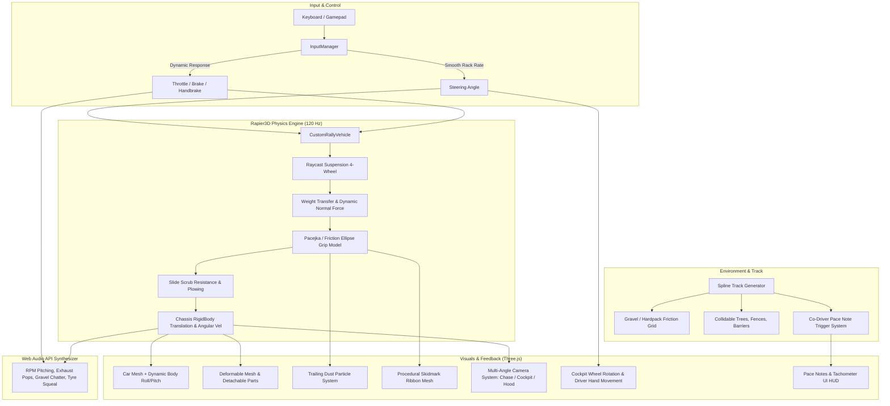
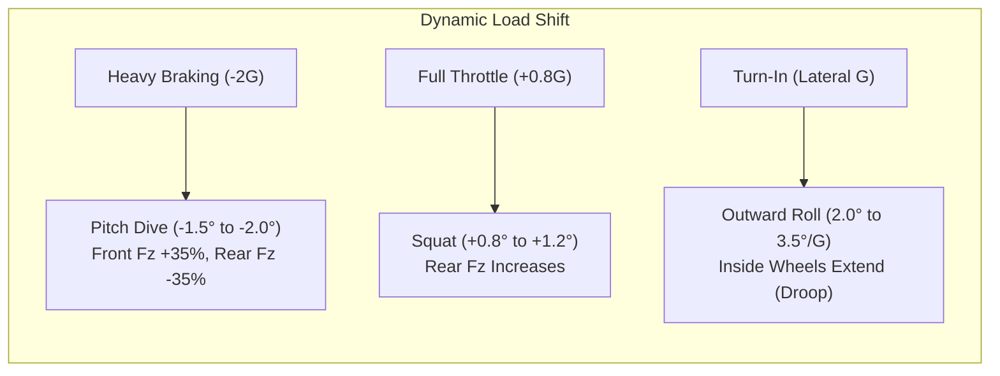
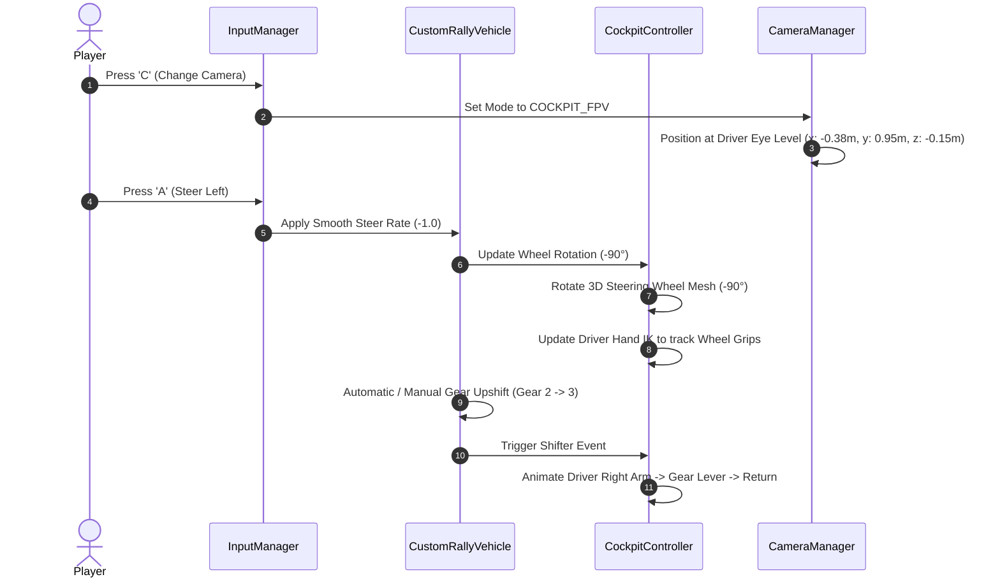
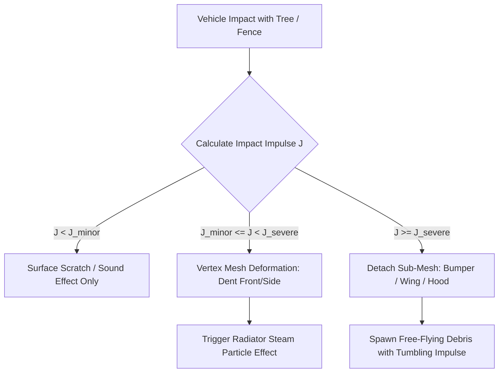

# APEX DIRT: MASTER BLUEPRINT & AGENT EXECUTION PROMPT

---

## 1. MISSION BRIEFING & HIGH-LEVEL ARCHITECTURE

You are the Lead Systems Architect and Gameplay Engineer tasked with building **Apex Dirt**, a stylized 1980s Group B retro-modern rally simulation game running in the browser using **TypeScript**, **Three.js** (WebGL rendering), and **Rapier3D** (rigid body physics).

### High-Level Architectural Flowchart



---

## 2. PHASE 0: SYSTEM AUDIT & BASELINE INVENTORY

Before altering any code or introducing new features, the agent must perform a read-only audit:
1. **Physics Substepping & Integration Timestep**:
   - Inspect `src/physics/PhysicsWorld.ts`.
   - Verify whether Rapier runs at a fixed timestep (`dt = 1/120s` or `1/60s`) and ensure vehicle substeps decouple from browser variable frame rates (`requestAnimationFrame`).
2. **Current Vehicle Pipeline**:
   - Inspect `src/vehicles/CustomRallyVehicle.ts` for raycast suspension, tyre lateral friction calculation, and drivetrain acceleration logic.
3. **Current Camera & Scene**:
   - Inspect `src/core/ChaseCamera.ts` and `src/main.ts` to identify how rendering interacts with physics positions.
4. **Active Dependencies**:
   - Inspect `package.json` for Three.js version (`>= 0.174.0`), Rapier (`@dimforge/rapier3d-compat`), and Vite build configuration.

---

## 3. PHASE 1: CAR DYNAMICS & VEHICLE PHYSICS (A TO Z)

### 3.1 Chassis & Mass Properties
- **Chassis Geometry**: Box dimensions $\approx 1.70\text{ m (width)} \times 0.64\text{ m (height)} \times 4.10\text{ m (length)}$, mass $\approx 1200\text{ kg}$.
- **Center of Gravity (CoG)**:
  - World height at static ride: $y \approx 0.55 - 0.65\text{ m}$.
  - Longitudinal balance: $52\%$ front / $48\%$ rear static axle distribution.
  - Lower CoG increases rollover threshold while preserving natural weight-transfer roll and dive.

### 3.2 Suspension Dynamics (Raycast System)
Each of the 4 corners (Front-Left, Front-Right, Rear-Left, Rear-Right) computes independent raycast physics:
- **Spring Model**:
  $$F_{\text{spring}} = k \cdot (L_{\text{rest}} - L_{\text{current}})$$
  - Front stiffness $k_f = 38,000 - 42,000\text{ N/m}$, Rear stiffness $k_r = 45,000 - 54,000\text{ N/m}$.
- **Two-Way Damping**:
  $$F_{\text{damper}} = -c \cdot v_{\text{suspension}}$$
  - Compression damping $c_{\text{comp}} \approx 2,400 - 3,000\text{ Ns/m}$ (absorbs bumps).
  - Rebound damping $c_{\text{reb}} \approx 3,200 - 4,000\text{ Ns/m}$ (prevents repeated pogo-bouncing).
- **Bump Stops & Droop Stops**:
  - Progressive rubber bump stop engaging at the final $5\text{ cm}$ of compression.
  - Droop limiter preventing wheels from dropping past maximum travel ($10 - 15\text{ cm}$ below static ride).
- **Anti-Roll Bars (ARB)**:
  - Cross-coupling between left and right wheels on the same axle to resist excess roll while allowing single-wheel articulation over gravel ruts.

### 3.3 Weight Transfer & Body Motion
- **Braking Dive**: Nose pitches down under negative longitudinal acceleration ($a_x < 0$). Front normal load $F_z$ increases, rear unloads.
- **Acceleration Squat**: Rear pitches down under positive acceleration, transferring grip to driven wheels.
- **Cornering Roll**: Lateral acceleration ($a_y = v^2 / R$) causes outward body roll. Front-to-rear roll stiffness distribution governs understeer vs oversteer balance.



### 3.4 Tyre Friction & Drifting Model
- **Friction Ellipse Formulation**:
  Tyre forces cannot exceed total available traction circle:
  $$\sqrt{\left(\frac{F_x}{\mu_x F_z}\right)^2 + \left(\frac{F_y}{\mu_y F_z}\right)^2} \le 1.0$$
- **Lateral Grip vs Slip Angle ($\alpha$)**:
  - Linear grip ramp up to peak slip angle $\alpha_{\text{peak}} \approx 7.5^\circ - 9.0^\circ$.
  - Controlled grip saturation falloff into sliding range ($15^\circ - 40^\circ$).
- **Gravel Slide Scrub (Plowing Resistance)**:
  - When a rally car drifts sideways at high slip angles, gravel piling against the tyre sidewalls produces continuous longitudinal deceleration ($\approx 0.8 - 1.1\text{ G}$), allowing the driver to modulate speed using drift angle alone.
- **Handbrake Mechanics**:
  - Rear wheel lockup instantly sets rear longitudinal slip ratio to $1.0$, dropping rear lateral grip and provoking rapid yaw rotation.
- **Counter-Steer Assist**:
  - Smooth steering rate limiter with rapid self-centering to make keyboard play responsive and controllable without twitching.

---

## 4. PHASE 2: VEHICLE STYLING, COCKPIT & DRIVER INTERACTION

### 4.1 Exterior Styling: 1980s Rally Legend
- **Inspiration**: Audi Sport Quattro S1 E2, Lancia 037, Peugeot 205 T16.
- **Aesthetic Attributes**:
  - Boxy flared wheel arches, vented hood louvers, front chin spoiler, and a prominent rear wing.
  - Rally light pod with 4 high-output lamps mounted on the hood.
  - Classic rally livery: bold two-tone geometric stripes, authentic mud-splatter base texture, and matte mud flaps.

### 4.2 Interactive Cockpit & Driver Animation (First-Person View)
- **First-Person Camera Switch**:
  - Pressing `C` cycles between:
    1. **Dynamic Chase Camera** (3rd-person, velocity-aligned).
    2. **Cockpit Driver Camera** (Eye level inside the cabin, viewing dashboard and steering wheel).
    3. **Hood / Bumper Camera** (Low forward view for maximum sensation of speed).
- **Cockpit Details**:
  - Analog tachometer / speedometer gauges with illuminated needles.
  - Roll cage tubing surrounding the cabin.
  - Center console with sequential rally gear shifter and vertical hydraulic handbrake lever.
- **Steering Wheel & Hand Animation**:
  - As the player steers (`A` / `D` or Analog Stick), the steering wheel turns smoothly up to $\pm 180^\circ$.
  - 3D Driver character model with racing gloves.
  - Driver arms utilize two-bone inverse kinematics (IK) or procedural bone rotation so the hands remain gripped to the wheel rim as it turns.
  - When the transmission shifts gears, the driver's right hand briefly releases the wheel, animates down to flick the gear shifter, and returns to the steering wheel.



---

## 5. PHASE 3: TRACK GENERATION, ENVIRONMENT & PACE NOTES

### 5.1 Procedural / Spline Dirt Stage
- **Curved Ribbon Mesh**:
  - Constructed using cubic Catmull-Rom or B-Splines.
  - Cross-section: $8.0\text{ m}$ road width, crowned center, banked corners (camber up to $4^\circ - 6^\circ$), transition shoulders with gravel run-offs.
  - Elevation changes: Natural rolling hills, crests (unweighting the car), and dips (compressing suspension).
- **Environment Props**:
  - Dense pine and broadleaf trees lining the stage.
  - Wooden boundary fences, hay bales, and red-and-white chevron boards marking acute corners.
  - Grassy verge banks with spectators cheering at designated apex zones.

### 5.2 Co-Driver Pace Note Audio & HUD Callouts
As the car approaches corners, the co-driver calls out notes and displays icons on the HUD:
- **Calling Format**:
  - `[Direction] [Severity] [Modifier]` (e.g., *"Right 4 into Left 2 tightens"*, *"Crest, flat out"*, *"Caution Hairpin Right"*).
  - Severity scale from 6 (gentle sweeper, high speed) down to 1 (acute 90-degree corner) and Hairpin.
- **Trigger System**:
  - Spatial checkpoint triggers placed along the spline arc length $s$, alerting the driver $2.0 - 3.0\text{ seconds}$ before corner entry.

---

## 6. PHASE 4: VISUAL DAMAGE & DETACHABLE BODY PARTS

### 6.1 Collision Detection & Deformation
- Rapier contact events provide impact point and impulse magnitude:
  $$J = m \cdot \Delta v$$
- **Low/Medium Impact ($J < J_{\text{severe}}$)**:
  - Localized vertex deformation on bumper, hood, or quarter-panel meshes around the collision coordinate.
  - Scrape and dent decal texturing.
- **High Impact ($J \ge J_{\text{severe}}$)**:
  - Detachment of sub-meshes: front bumper, hood, side mirrors, and rear spoiler.
  - Detached parts become dynamic Rapier rigid bodies with gravity and tumbling inertia, scattering across the track.



---

## 7. PHASE 5: PARTICLES, SHADERS & AUDIO

### 7.1 Visual Particle & Skid Systems
- **Trailing Dirt Cloud**:
  - Billboard particle system spawned at rear tyre contact patches.
  - Density and size scale dynamically with rear wheel slip velocity and surface dryness.
  - Particles drift backwards and expand with atmospheric wind dissipation.
- **Persistent Skid Marks**:
  - Dynamic procedural ribbon mesh generated under sliding tyres ($\text{slip} > 8^\circ$ or lockup).
  - Skids conform to ground elevation with a slight polygon offset ($+2\text{ cm}$) to avoid Z-fighting.
- **Exhaust Backfires**:
  - Point light flicker and particle flame burst from exhaust tips on throttle lift-off / downshifts.

### 7.2 Web Audio API Procedural Sound Engine
- **Engine Synthesizer**:
  - Multi-oscillator synthesis modulated by engine RPM ($1,000 - 8,500\text{ RPM}$).
  - Intake roar and high-frequency turbocharger whine proportional to boost pressure.
  - Turbo wastegate blow-off valve flutter on throttle lift.
- **Gravel Chatter & Surface Noise**:
  - Filtered white noise modulated by wheel angular velocity and surface roughness.
  - Tyre screech on asphalt vs gravel churn sounds.

---

## 8. STEP-BY-STEP AGENT EXECUTION ROADMAP

When assigning this blueprint to an autonomous agent, execute in strict phases:

```
[Phase 1: Environment & Build Verification]
  ├── Step 1.1: Verify project compiles cleanly with 'npm run build'.
  └── Step 1.2: Check PhysicsWorld timestep consistency across harnesses.

[Phase 2: Core Dynamics & Suspension Realism]
  ├── Step 2.1: Audit raycast suspension travel, progressive bump stops, and droop limiters.
  ├── Step 2.2: Implement dynamic weight transfer and lateral load roll calculation.
  └── Step 2.3: Validate gravel slide-scrub deceleration under high-angle drifts.

[Phase 3: Interactive Cockpit & Camera Rig]
  ├── Step 3.1: Implement multi-camera manager (Chase, Cockpit FPV, Hood).
  ├── Step 3.2: Model interior dashboard, animated steering wheel, and shifter.
  └── Step 3.3: Wire driver arm IK / rotation synchronized with steering and gear shifts.

[Phase 4: Track Stage & Pace Notes]
  ├── Step 4.1: Construct spline dirt stage with camber, crests, and drift run-offs.
  ├── Step 4.2: Implement co-driver pace notes trigger system and HUD icons.
  └── Step 4.3: Populate roadside colliders (trees, fences, chevrons).

[Phase 5: Visual Damage & Collision FX]
  ├── Step 5.1: Wire Rapier collision contact impulses to mesh deformation.
  └── Step 5.2: Implement detachable parts (bumpers, hood, wing) as physics debris.

[Phase 6: Audio, Particles & Polish]
  ├── Step 6.1: Deploy dynamic dust cloud particles and persistent skid ribbons.
  ├── Step 6.2: Complete Web Audio synthesizer for RPM, backfire pops, and gravel churn.
  └── Step 6.3: Run final verification battery across keyboard and gamepad inputs.
```

---

## 9. CURATED BENCHMARK REPOSITORIES & GAME REFERENCES

### 9.1 Open-Source GitHub Repositories for Reference
1. **Three.js Vehicle Physics**:
   - `mrdoob/three.js` (WebGL car materials & shader pipelines): [https://github.com/mrdoob/three.js](https://github.com/mrdoob/three.js)
   - `pmndrs/use-cannon` / `use-rapier` (Raycast vehicle architecture examples): [https://github.com/pmndrs/use-cannon](https://github.com/pmndrs/use-cannon)
2. **Procedural Splines & Track Generation**:
   - `bobbyrobert/threejs-track-generator` (Spline ribbons, road banking, and collision hulls): [https://github.com/bobbyrobert](https://github.com/bobbyrobert)
   - `BabylonJS/Babylon.js` (Curve path extrusion algorithms): [https://github.com/BabylonJS/Babylon.js](https://github.com/BabylonJS/Babylon.js)
3. **Web Audio Vehicle Synthesis**:
   - `Sonoport/sound-design-web-audio` (Procedural vehicle engine oscillators): [https://github.com/](https://github.com/)

### 9.2 Benchmark Commercial Games to Study
1. **Art of Rally** (Funselektor Labs):
   - *Key takeaway*: Minimalist aesthetic paired with uncompromisingly deep, rewarding counter-steering and weight transfer mechanics.
   - *Reference*: [https://funselektor.com/art-of-rally](https://funselektor.com/art-of-rally)
2. **Dirt Rally 2.0 / EA Sports WRC** (Codemasters):
   - *Key takeaway*: Benchmark for authentic co-driver pace notes, heavy gravel braking scrub, and suspension droop over crests.
   - *Reference*: [https://www.ea.com/games/ea-sports-wrc](https://www.ea.com/games/ea-sports-wrc)
3. **Rush Rally 3** (Brownmonster Limited):
   - *Key takeaway*: High-performance real-time car deformation, detachable bumpers, wheel mud accumulation, and fluid multi-angle cockpit cameras.
   - *Reference*: [https://www.brownmonster.co.uk/rush-rally-3](https://www.brownmonster.co.uk/rush-rally-3)
4. **Sega Rally Championship**:
   - *Key takeaway*: Accessible arcade handbrake flick transitions with exaggerated, satisfying slide dynamics.

